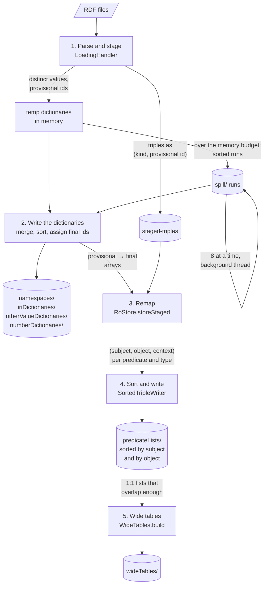

# Loading

How RDF files become a sparql-readonly store, what each step costs, and what
limits it. This describes what is implemented. The on-disk result is
described in [storage.md](storage.md); the design history and rejected
options are in [loading-investigation.md](loading-investigation.md).

## Using it

```
java -Xmx4g -cp ... sib.swiss.swissprot.sparql.ro.Loader <store-directory> <rdf-file>...
```

or from code:

```java
RoStore store = new RoStore();
store.setDataDir(directory);
store.setLoadMemory(64L << 20);   // optional, see "Memory"
store.setWideTableOverlap(90);     // optional, see "5. Wide tables"
store.init();
store.load(files);
```

Any RDF format RDF4J's Rio recognises by file name is read. Files it does
not recognise are skipped with a warning. A native executable of the loader
can be built with `mvn -Pnative package` (GraalVM).

## The flow

The RDF is parsed once. Every value gets a *provisional id* while parsing,
because its final id depends on where it ends up in a sorted dictionary,
which is only known once all values are seen. Triples are kept with their
provisional ids in a staging file until the dictionaries are written, then
translated to their final ids and written, sorted, into the triple lists.



### 1. Parse and stage

`LoadingHandler` receives each statement from the parser and identifies its
subject, predicate, object and context:

| Value | Kind | Id while staging |
| --- | --- | --- |
| IRI | `IRI` | provisional, in the IRI namespace group |
| blank node | `BNODE` | final: a counter for the whole load (labels are local to their file) |
| `xsd:int` | `INT` | final: the value |
| `xsd:boolean` | `BOOLEAN` | final: 1 or 0 |
| `xsd:integer`, a long without the high bit | `INTEGER` | final: the value |
| `xsd:integer`, anything else | `BIG_INTEGER` | provisional, in the integer dictionary |
| any other literal | `LITERAL` | provisional, in the group of its language or datatype |

A literal whose label is not valid for its datatype (`"abc"^^xsd:int`) is a
`LITERAL`.

A provisional id is `group << 32 | n`, where `n` counts the distinct values
of the group in the order they are first seen (`ProvisionalGroup`). The
groups are an IRI namespace (the IRI up to its last `/` or `#`; an IRI that
ends in `/` belongs to the namespace one level up), a literal language, a
literal datatype, and the big integers.

The statement is appended to `staged-triples`, a Parquet file of seven
columns: the kind and id of subject, predicate (always an IRI), object and
context (`StagedTriples`).

**Memory budget.** All groups share one budget for the values they hold. When
it is exceeded, the largest groups write their values, sorted, with their
provisional ids as a *run* in `spill/`, and start empty, until half the
budget is free. A value seen again after its group spilled gets another
provisional id; the duplicates meet when the runs are merged. A background
thread merges a group's runs eight at a time as soon as there are eight,
while parsing continues.

While the values come in, each IRI namespace also records whether all its
local names are a common prefix followed by a number of a fixed length, such
as `GO_0005634`. Such a namespace is stored as a bitmap of numbers instead of
a list of names.

### 2. Write the dictionaries

Each group is finished on its own: its pending merges are awaited, its runs
merged down to at most eight, and those merged with the values still in
memory into one sorted stream of distinct values. Each value is written to
its dictionary and its final id recorded for every provisional id it got, in
an array per group (8 bytes per provisional id).

| Dictionary | Final id |
| --- | --- |
| IRI namespace | `namespace << 32 \| row of the name in the namespace`, or `\| number` for a prefix-and-number namespace. Namespaces are numbered largest first; all names go into one file. |
| literals | the row in one file holding all groups, each sorted |
| big integers | the row, with the high bit set |

### 3. Remap

`staged-triples` is read once, in order. Each id is mapped to its final id
through the arrays, which is an array index, not a lookup. The triple is
handed to the builder of its predicate, which picks the triple list for its
subject and object kind.

### 4. Sort and write the triple lists

Each list buffers its triples, up to a million. A full buffer is sorted by
subject, then object, and written as a run next to the list. Building the
list merges its runs, 64 at a time, into the list file; a list that never
filled its buffer is sorted in memory and written once. Exact duplicate
triples are stored once. The rows of the triples in each named graph are
recorded in a bitmap per graph.

The list is then read back and written again sorted by object, then
subject, as the list's `-by-object` copy.

### 5. Wide tables

The lists with one object per subject are read for their subjects, grouped by how much their subjects overlap, and each group
of two or more is written as a wide table in `wideTables/`
(`WideTables.build`). The lists of a group are then replaced by a pointer
to their column, and the rows in their `-graphs` files are translated to
rows of the table. See "Wide tables" in [storage.md](storage.md) for the
grouping and the `wideTableOverlap` setting.

Finally the staging file, the spill directory and all runs are deleted,
the prefixes declared in the files are written to `namespaces/prefixes`, and
directories the load left empty are removed.

## Memory

| Setting | Default | What it bounds |
| --- | --- | --- |
| `RoStore.setLoadMemory(bytes)`, or `-Dsparql.ro.loadMemoryMB` for `Loader` | a quarter of the heap | the distinct values held while parsing |
| `ParquetTable.LIST_CONFIG` | row groups of 64k triples or 4 MB | the write buffer of each open triple list and of the staging file |
| `SortedTripleWriter.RUN_TRIPLES` | 1 048 576 | the sort buffer of a triple list, 20 bytes a triple |

Not bounded by a setting:

- the provisional → final arrays, 8 bytes per provisional id;
- the open triple lists: one writer and one sort buffer per non-empty list
  of every predicate, so memory grows with the number of predicates.

`taxonomy.rdf` (16.5M triples) loads in a 512 MB heap with a 64 MB budget.

## Measured

`taxonomy.rdf`, 16.5M triples, 1.4 GB of RDF/XML; 8 cores, `-Xmx4g`, JDK 27.

| Step | Default budget |
| --- | --- |
| 1. Parse and stage | 72 s |
| 2. Write the dictionaries | 14 s |
| 3. Remap | 9 s |
| 4. Sort and write the triple lists | 15 s |
| Whole load | 110 s |

With a 64 MB dictionary budget the dictionaries spill 23 runs; parsing then
takes longer and writing the dictionaries shorter. The resulting store is
100 MiB in 67 files; see [storage.md](storage.md) for what it holds. Both taxonomy files together, 55.9M triples (53.5M distinct), load
and are counted back in under five minutes in `RoStoreTest`.

## Bottlenecks

1. **Parsing** is one thread: about 365 000 RDF/XML statements a second for
   parsing alone, 240 000 with staging. Several files could be parsed in
   parallel, each with its own handler, if the temp dictionaries were made
   thread safe.
2. **Staging is written on the parsing thread.** Its rate drops while
   hardwood compresses a row group of the staging file. Writing from a
   second thread would hide that.
3. **Every list is written twice,** once per sort order; the copy sorted by
   object is made by reading back the first.
4. **Memory beyond the budget** grows with the number of distinct values
   (the remap arrays) and with the number of predicates (open lists).

## Limitations

- Named graphs are recorded while loading but not used when reading:
  statements come back without their context.
- Loading into a directory that already holds a store is not supported: the
  triple lists of predicates that only the earlier load had would remain.
