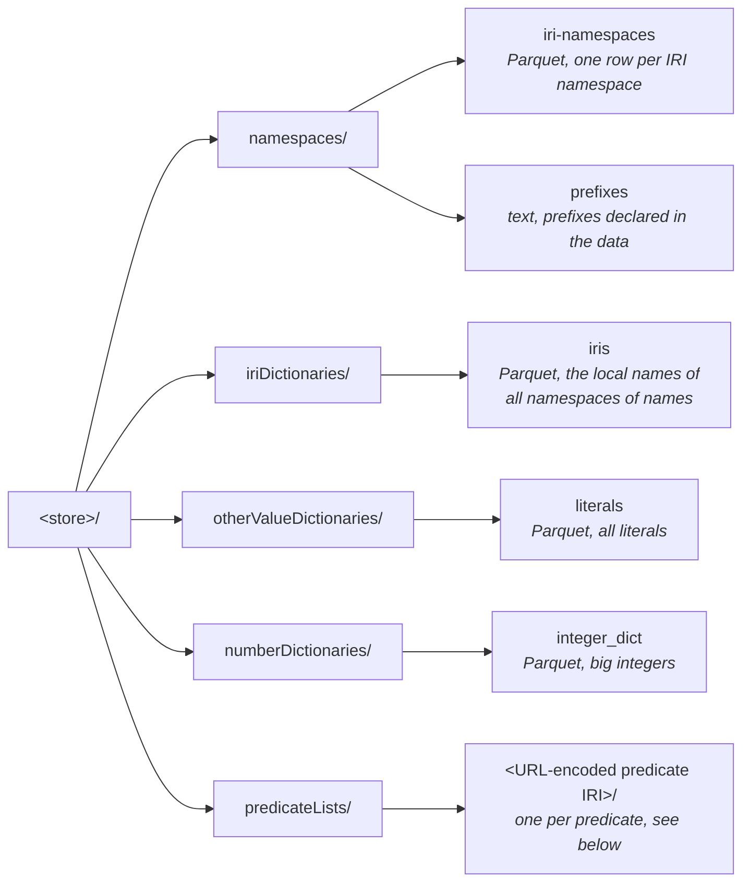
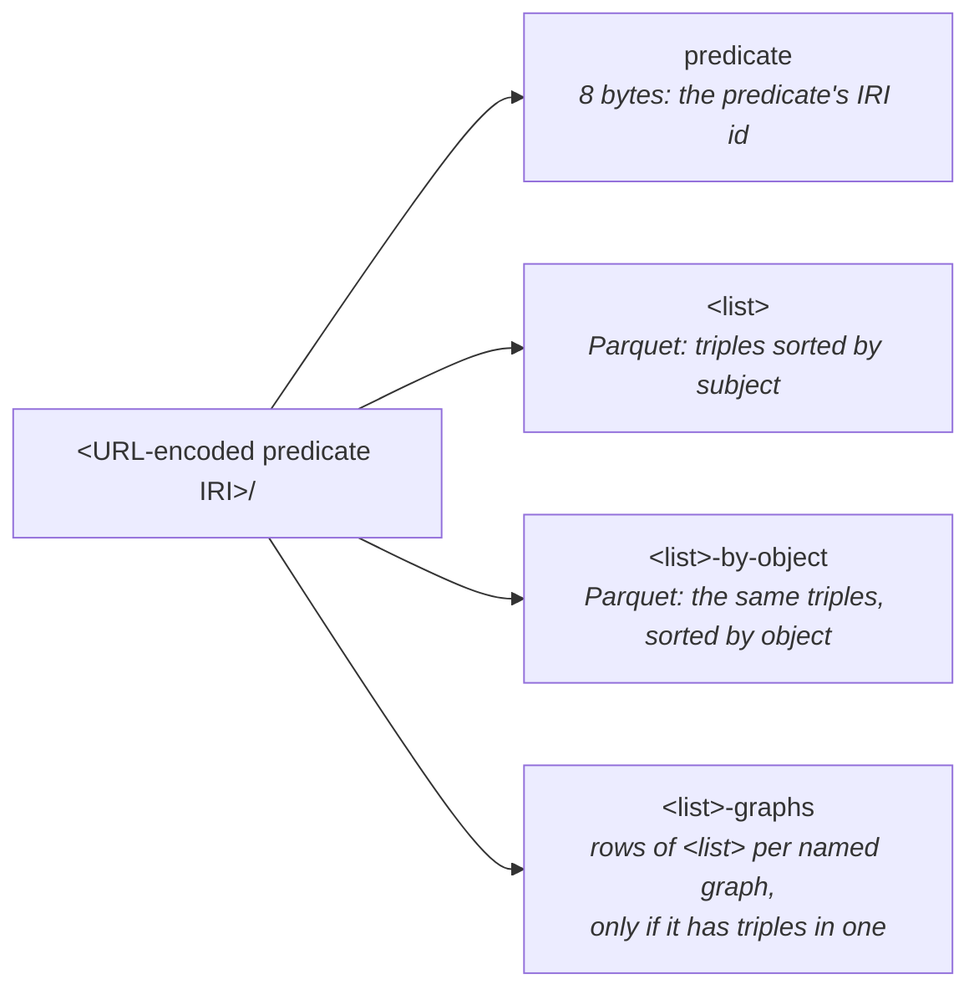
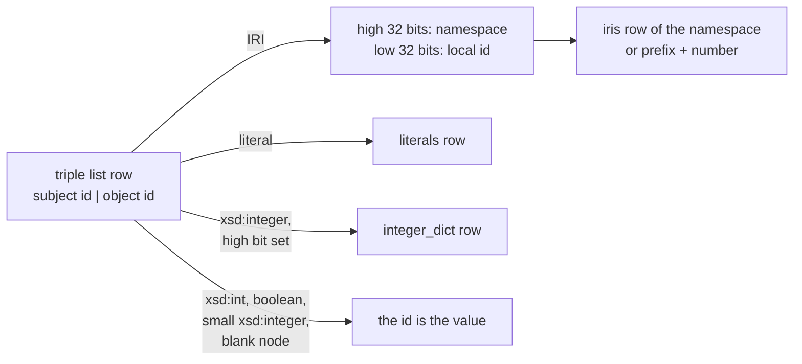
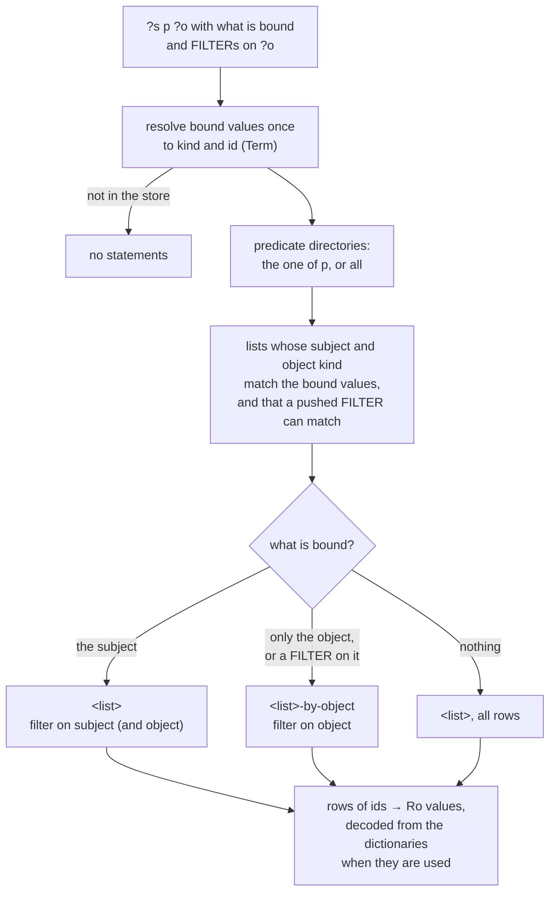
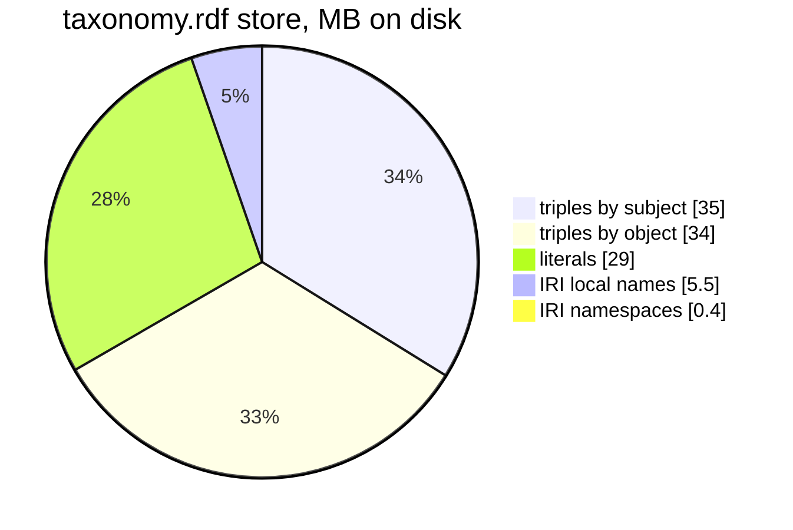

# Storage

What a sparql-readonly store holds on disk, how the files refer to each
other, and how reading a statement pattern uses them. This describes what is
implemented; [loading.md](loading.md) describes how the files are written.

The numbers are from a store of `taxonomy.rdf` (16.5M triples, 21
predicates): 100 MiB on disk in 67 files.

## Layout

All data files are Parquet, written with [hardwood](https://hardwood.dev),
compressed with zstd. The other files are small binary or text files.

A directory or file that would be empty is not there: a store without big
integers has no `numberDictionaries/`, one without literals no
`otherValueDictionaries/`.

Inside each predicate directory, per non-empty triple list `<list>`:

### Triple lists

Each predicate has a directory with up to 13 triple lists, one per kind of
subject and kind of object. Only lists with triples have files.

| Subject \ object | IRI | blank node | dictionary literal | `xsd:int` | boolean | `xsd:integer` |
| --- | --- | --- | --- | --- | --- | --- |
| **IRI** | `iri_iri` | `iri_bnode` | `iri_literal` | `iri_integer` | `iri_boolean` | `iri_big_integer` |
| **blank node** | `bnode_iri` | `bnode_bnode` | `bnode_literal`, `bnode_string` | `bnode_integer` | `bnode_boolean` | `bnode_big_integer` |

A list file has two columns, `subject` and `object`, both `INT64` ids (see
"Ids"). It is sorted by subject, then object, and holds every triple once.
Its `-by-object` copy holds the same triples sorted by object, then subject.
Row groups hold 64k triples, so that statistics on the sorted column let a
lookup skip all but the row group that holds its value.

A `-graphs` file holds the number of named graphs, then per graph whether
it is an IRI, its id and a serialized `RoaringBitmap` of the rows of the list
in that graph.

### Dictionaries

| File | Columns | Row groups | Sorted by |
| --- | --- | --- | --- |
| `namespaces/iri-namespaces` | `id` INT64, `namespace` string; for a prefix-and-number namespace also `number_prefix` string, `name_length` INT32, `numbers` bytes | default | id |
| `iriDictionaries/iris` | `namespace` INT64, `id_col` INT64, `iri_value` string | 4096 rows | namespace, then local name |
| `otherValueDictionaries/literals` | `id_col` INT64, `label` string, `datatype` string, `language` optional string | 4096 rows | label, within each language or datatype |
| `numberDictionaries/integer_dict` | `id_col` INT64, `int_long_value` string | 4096 rows | numeric value |

In `iris` the `id_col` is the row of the name within its namespace; in the
other dictionaries it is the row in the file. Small row groups let a lookup
by id or by value decode only 4096 rows; in `iris`, statistics on the
namespace column first narrow a lookup to its namespace.

A namespace whose local names are all one prefix followed by a number of one
length (`GO_0005634`) has no names in `iris`: its row in `iri-namespaces`
holds the prefix, the length and a serialized `RoaringBitmap` of the numbers
present.

`RoStore.init()` on a directory that holds a store opens all of these, so a
store can be loaded by one process and read by another.

## Ids

Every value in a triple list is a 64-bit id. Which dictionary, if any, gives
its value follows from the list it is in.

| Kind | Id |
| --- | --- |
| IRI | `namespace (32 bits) \| local id (32 bits)`: the local id is the row of the name within its namespace in `iris`, or the number after the prefix. Namespaces are numbered largest first. |
| blank node | a number given while loading |
| dictionary literal | the row in `literals` |
| `xsd:int` | the value |
| boolean | 1 or 0 |
| `xsd:integer` | the value if it is a long without the high bit; otherwise the row in `integer_dict` with the high bit set |

## Reading a statement pattern

Bound values that came from this store, as in a join, carry their id;
others are looked up in the dictionaries once per pattern. A FILTER that
compares the object with a number, or with a boolean, is pushed down as a
range or set on the object column of the lists where values are stored as
themselves, and rules out lists that can not match; the FILTER itself is
still applied to what is read.

On the taxonomy store: one subject and predicate, 6 ms; one object and
predicate (3 statements), 5 ms; all statements of one subject, 68 ms.

### Stars of patterns

Patterns that are joined and share an unbound subject variable, such as
`?s up:scientificName ?name ; up:rank ?rank ; rdfs:subClassOf ?parent`,
are evaluated together (`StarJoinOptimizer`, `StarJoinStep`):

- with the subject bound by an enclosing join, each pattern is a lookup of
  that subject;
- if a pattern with a bound object has at most 1000 triples, its subjects
  are looked up in the other patterns;
- otherwise the lists of all patterns, sorted by subject, are read once and
  merged, with bound objects as filters on those lists: a subject every
  pattern has gives the combinations of its objects.

On the taxonomy store all 1.9 million species with their name and parent
take 4 s; one lookup per pattern per species, as a nested loop join does,
takes about 8.5 ms per row, hours in all.

## What the store consists of

## Duplication, and how it was removed

The first version of this store, at 583 MiB and about 27 000 files, held:

1. **A copy of the namespace table next to every triple list,** also lists
   without triples: 273 identical files of 1.46 MB, two thirds of the store,
   that nothing read, and 26 of the 40 seconds of writing the triple lists.
   The table is now written once, as `namespaces/iri-namespaces`, and read
   by `RoStore.init()`.
2. **Two context files per list, also without named graphs:** 546 files. A
   list now has one `-graphs` file, only if it has triples in a named graph.
3. **One dictionary file per namespace:** 25 912 files holding 11.7 MB in
   111 MB of filesystem blocks. All local names are now in one file, `iris`,
   and the prefix-and-number namespaces in the rows of `iri-namespaces`.
4. **Directories that were never written** are no longer created, and a
   load removes the directories it left empty.

Together this brought the store to 100 MiB in 67 files, and loading from
137 to 110 s. Lookups that resolve an IRI became about 2 ms slower, as the
IRI file is now shared by all namespaces; large namespaces could get a file
of their own again if that matters.

What is still duplicated:

- **The copy sorted by object,** 34 MB, every triple twice. It is what makes
  lookups by object fast, so it is worth its size for large lists. For lists
  of one row group, 64k triples or less, it gains nothing: 12 of the 21
  taxonomy lists, though only 1.2 MB of the 34. These could skip it, as
  could lists with a single distinct object.
- **The same subjects in the lists of several predicates,** see TODO item 7.
- `bnode_string` lists are never filled: loading puts blank node subjects
  with literal objects in `bnode_literal`.

## Limitations

- Context bitmaps are written but not read: statements come back without
  their context.
