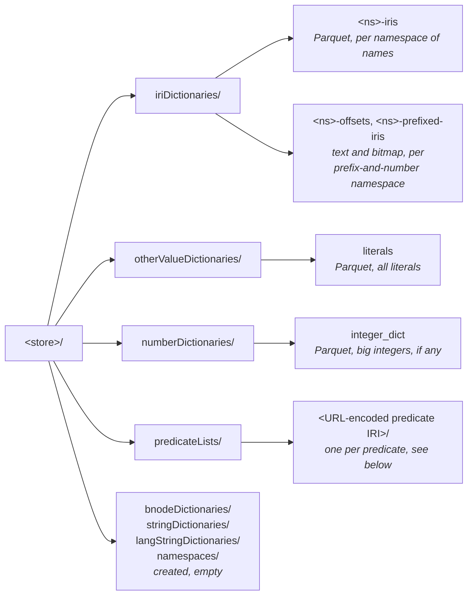
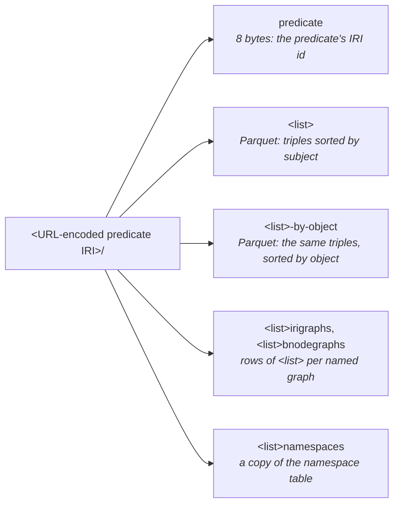
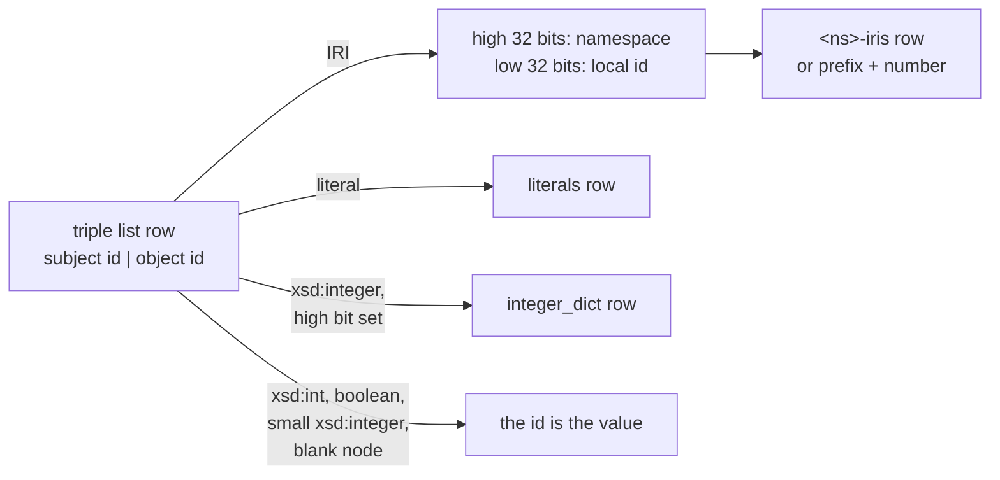
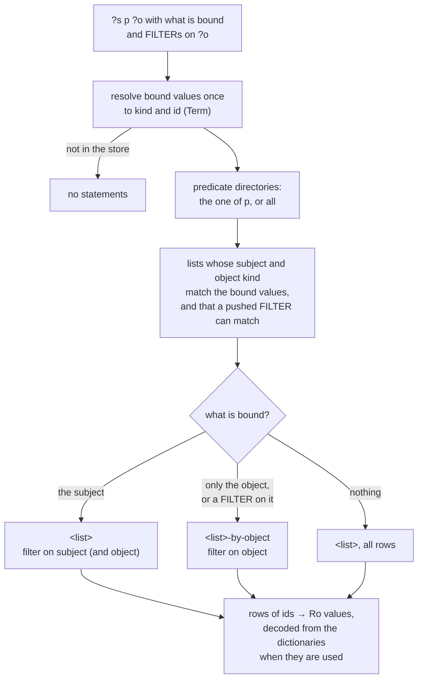
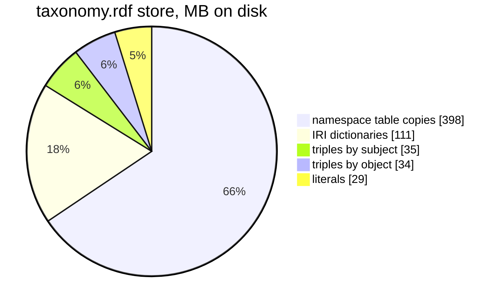

# Storage

What a sparql-readonly store holds on disk, how the files refer to each
other, and how reading a statement pattern uses them. This describes what is
implemented; [loading.md](loading.md) describes how the files are written.

The numbers are from a store of `taxonomy.rdf` (16.5M triples, 21
predicates), 583 MiB on disk.

## Layout

All data files are Parquet, written with [hardwood](https://hardwood.dev),
compressed with zstd. The other files are small binary or text files.

Inside each predicate directory, per non-empty triple list `<list>` (and,
today, also per empty one for the last two):

### Triple lists

Each predicate has a directory with up to 13 triple lists, one per kind of
subject and kind of object. Only lists with triples have files.

| Subject \ object | IRI | blank node | dictionary literal | `xsd:int` | boolean | `xsd:integer` |
| --- | --- | --- | --- | --- | --- | --- |
| **IRI** | `iri_iri` | `iri_bnode` | `iri_literal` | `iri_integer` | `iri_boolean` | `iri_big_integer` |
| **blank node** | `bnode_iri` | `bnode_bnode` | `bnode_literal`, `bnode_string` | `bnode_integer` | `bnode_boolean` | `bnode_big_integer` |

A list file has two columns, `subject` and `object`, both `INT64` ids (see
"Ids"). It is sorted by subject, then object, and holds every triple once.
Its `-by-object` copy holds the same triples sorted by object, then subject.
Row groups hold 64k triples, so that statistics on the sorted column let a
lookup skip all but the row group that holds its value.

The context files are Java serialized: the number of graphs, their ids, then
a `RoaringBitmap` per graph of the rows of the sorted-by-subject list in that
graph.

### Dictionaries

| File | Columns | Row groups | Sorted by |
| --- | --- | --- | --- |
| `iriDictionaries/<ns>-iris` | `id_col` INT64, `iri_value` string | 4096 rows | local name |
| `otherValueDictionaries/literals` | `id_col` INT64, `label` string, `datatype` string, `language` optional string | 4096 rows | label, within each language or datatype |
| `numberDictionaries/integer_dict` | `id_col` INT64, `int_long_value` string | 4096 rows | numeric value |

`id_col` is the row number. Small row groups let a lookup by id or by value
decode only 4096 rows.

A namespace whose local names are all one prefix followed by a number of one
length (`GO_0005634`) has no `-iris` file. Its `<ns>-offsets` text file holds
the prefix length, the prefix and the minimum and maximum name length, and
`<ns>-prefixed-iris` a serialized `RoaringBitmap` of the numbers present.

## Ids

Every value in a triple list is a 64-bit id. Which dictionary, if any, gives
its value follows from the list it is in.

| Kind | Id |
| --- | --- |
| IRI | `namespace (32 bits) \| local id (32 bits)`: the local id is the row in `<ns>-iris`, or the number after the prefix. Namespaces are numbered largest first. |
| blank node | a number given while loading |
| dictionary literal | the row in `literals` |
| `xsd:int` | the value |
| boolean | 1 or 0 |
| `xsd:integer` | the value if it is a long without the high bit; otherwise the row in `integer_dict` with the high bit set |

## Reading a statement pattern

Bound values that came from this store, as in a join, carry their id;
others are looked up in the dictionaries once per pattern. A FILTER that
compares the object with a number, or with a boolean, is pushed down as a
range or set on the object column of the lists where values are stored as
themselves, and rules out lists that can not match; the FILTER itself is
still applied to what is read.

On the taxonomy store: one subject and predicate, 3.4 ms; one object and
predicate (3 statements), 3.3 ms; all statements of one subject, 48 ms.

## What the store consists of

The IRI dictionaries hold 11.7 MB of data; the rest is filesystem blocks of
their 25 912 small files. Context files, `predicate` files and the integer
dictionary are under 2 MB together.

## Duplication, and how to remove it

### 1. The namespace table, once per triple list: 398 MB, 26 s of loading

Every triple list writes the whole IRI namespace table next to it, also lists
without triples: 273 identical files of 1.46 MB in the taxonomy store, two
thirds of the store. Nothing reads them back. Writing them, unbuffered, is
26 of the 40 seconds of the last loading step.

**Proposal:** write the table once, buffered, into the existing, empty
`namespaces/` directory, and read it in `RoStore.init()`. That also is the
first piece needed to reopen a store, which does not work today. Without the
copies the taxonomy store is 202 MiB instead of 583 MiB.

### 2. Context files for lists without named graphs: 546 files

Every list writes two context files, also when it has no named graphs, as
here. They hold 10 bytes each but take a filesystem block each.

**Proposal:** write them only for lists with triples in named graphs. Better,
one file per predicate with a graph column, as the rows are those of one
sorted list.

### 3. One file per namespace: 25 912 files, 11.7 MB of data in 111 MB

The taxonomy has many tiny namespaces, such as `taxonomy/7227#` for the
strains of one species: 16 508 `-iris` files, most under 1 KB, and 4 702 pairs
of `-offsets` and `-prefixed-iris` files of a few bytes. Each costs a
filesystem block, a Parquet footer, and an open reader at query time.

**Proposal:** one Parquet file for all namespaces of names, with a namespace
column, sorted by namespace, then local name. Ids stay as they are; a lookup
filters on namespace and name, and statistics skip to its row group. Large
namespaces could keep a file of their own. The prefix-and-number namespaces
fit in one small file of prefix, lengths and bitmap per row.

### 4. The copy sorted by object: 34 MB, every triple twice

The `-by-object` copy is as large as the lists themselves. It is what makes
lookups by object fast, so it is worth its size for large lists. For lists
of one row group, 64k triples or less, it gains nothing, as there is no row
group to skip: 12 of the 21 taxonomy lists, though only 1.2 MB of the 34.

**Proposal:** skip the copy for lists of one row group, and for lists with a
single distinct object, where both orders are the same. Leave it for the
rest. An index from object to row groups of the list sorted by subject would
be smaller, but slower for objects spread over the list.

### 5. The same subjects in the lists of several predicates

`partOfLineage`, `scientificName`, `subClassOf` and `rank` each have one
object per taxon and largely the same taxa, so their lists hold mostly the
same subject column four times. Sorted ids compress well, so this is a few MB
for the taxonomy rather than a large share. The gain of merging such lists
into one wider table (TODO item 7) is in queries: a star of patterns on one
subject becomes one read instead of a join.

### 6. Leftovers

- `bnodeDictionaries/`, `stringDictionaries/` and `langStringDictionaries/`
  are created and never written; `namespaces/` too, until proposal 1.
- `bnode_string` lists are never filled: loading puts blank node subjects
  with literal objects in `bnode_literal`.

## Limitations

- A store can only be read by the process that loaded it, see
  [loading.md](loading.md).
- Context bitmaps are written but not read: statements come back without
  their context.
